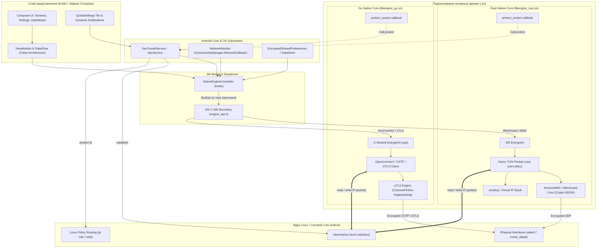
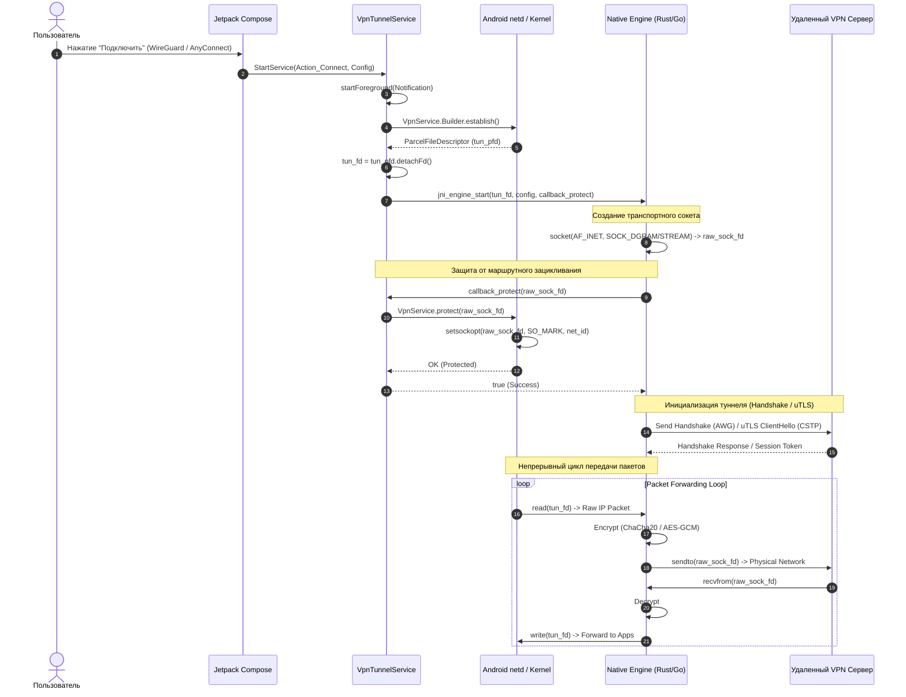

# Архитектурный анализ и системный дизайн мобильного VPN-клиента для Android (Rust + Go + Kotlin)

## 1. Введение и исполнительное резюме

Создание современного мобильного VPN-клиента под Android с высокими требованиями к энергоэффективности, производительности, безопасности и устойчивости к блокировкам (DPI/цензура) требует гибридного подхода. Ни один язык сам по себе не покрывает весь спектр задач идеально:
- **Rust** обеспечивает детерминированную производительность без сборщика мусора (Zero-cost abstractions, zero-allocation memory footprint), безопасность работы с сырыми пакетами (L3/TUN), прямое взаимодействие с ядром через Linux syscalls без накладных расходов JNI/CGO, а также лучшую энергоэффективность для тяжелых протоколов (WireGuard / AmneziaWG).
- **Go** обладает зрелой, непревзойденной экосистемой для обхода цензуры и корпоративных VPN: развитая реализация `uTLS` (с эмуляцией TLS ClientHello браузеров Chrome/Firefox, ALPN, GREASE, cipher suites), готовые стеки для протоколов AnyConnect (CSTP/DTLS via OpenConnect), Shadow-socks, V2Ray, Sing-box, а также высокая скорость разработки сложной сетевой бизнес-логики.
- **Kotlin + Jetpack Compose** — эталонный слой для Android: нативный жизненный цикл, управление Android `VpnService`, системные нотификации, QuickSettings Tiles, фоновые воркеры (WorkManager), обработка смены сетей (`ConnectivityManager`) и нулевой оверхед по сторонним тяжелым рантаймам.

В данном отчете представлен глубокий системный анализ взаимодействия этих технологий, деталей реализации сетевого стека Android, сравнительный анализ рантаймов, модели сборки и конкретные архитектурные рекомендации.

---

## 2. Архитектурная специфика подсистемы Android VPN

### 2.1. Внутреннее устройство `VpnService` и TUN-интерфейса

Android предоставляет разработчикам виртуальных частных сетей специализированный API — `android.net.VpnService`. В основе его работы лежит стандартный виртуальный сетевой интерфейс Linux TUN (Network TUN/TAP driver, работающий на 3-м уровне модели OSI — Network Layer / IP packets).

#### Механизм создания и захвата дескриптора (`ParcelFileDescriptor`):
1. **Подготовка**: Пользовательское приложение запрашивает системное разрешение через `VpnService.prepare(context)`. Если разрешение еще не выдано, система показывает системный диалог с ключом доверия (`Consent Activity`).
2. **Конфигурация через `VpnService.Builder`**:
   - `addAddress(String address, int prefixLength)`: Назначает виртуальный IP-адрес интерфейсу (IPv4 и/или IPv6, например `10.8.0.2/24`, `fd00::2/64`).
   - `addRoute(String address, int prefixLength)`: Определяет диапазоны IP, которые ядро Linux должно маршрутизировать в данный TUN-интерфейс (для Full-tunnel обычно `0.0.0.0/0` и `::/0`).
   - `addDnsServer(String address)`: Указывает DNS-серверы для туннеля (предотвращение DNS Leaks).
   - `setMtu(int mtu)`: Задает Maximum Transmission Unit (типично 1280–1420 байт с учетом оверхеда заголовков WireGuard / DTLS / IP).
   - `setBlocking(boolean blocking)`: Режим чтения дескриптора (блокирующий или неблокирующий).
3. **Финализация (`establish()`)**:
   Вызов `Builder.establish()` отправляет межпроцессный запрос через Binder в системный сервис `ConnectivityService` / `netd`. Система создает виртуальный интерфейс `tunX` и возвращает объект `ParcelFileDescriptor`.
4. **Передача `fd` в нативный уровень**:
   Для исключения накладных расходов Java I/O (`FileInputStream`), дескриптор извлекается в виде примитива `int fd`:
   ```kotlin
   val pfd: ParcelFileDescriptor = builder.establish() ?: throw VpnEstablishException()
   val fd: Int = pfd.detachFd() // detachFd() передает владение дескриптором нативному коду
   // Либо pfd.fd / pfd.dup().detachFd() если требуется сохранить контроль в Java
   ```
   После передачи `int fd` в Rust или Go, чтение и запись IP-пакетов производятся стандартными системными вызовами `read()` / `write()` (или векторными `readv()` / `writev()`, а на современных ядрах Android 12+ — асинхронными очередями `io_uring` при наличии доступа).

```
+---------------------------------------------------------------------------------+
|                                 Android Framework                               |
|  +--------------------+       Binder IPC        +----------------------------+  |
|  | Kotlin VpnService  | ---------------------> | System ConnectivityService |  |
|  |  (VpnService.Bld)  |                         |        (netd / netlink)    |  |
|  +--------------------+                         +----------------------------+  |
|           | establish() -> ParcelFileDescriptor               |                 |
|           v                                                   v                 |
|     detachFd() -> int fd                             Create kernel TUN `tunX`   |
+-----------|---------------------------------------------------|-----------------+
            | JNI pass fd                                       |
            v                                                   v
+---------------------------------------------------------------------------------+
|                       Native Engine (Rust / Go Core)                            |
|                                                                                 |
|   raw loop: read(fd, buf) -> Encrypt -> protect(sock) -> sendto(remote_ip)     |
|             recvfrom(sock) -> Decrypt -> write(fd, buf)                         |
+---------------------------------------------------------------------------------+
```

---

### 2.2. Механизм защиты сокетов от зацикливания (`Routing Loop Prevention`)

#### Проблема зацикливания:
Когда в `VpnService.Builder` добавляется маршрут `0.0.0.0/0`, ядро Linux направляет **все** исходящие IP-пакеты системы в созданный интерфейс `tunX`. Если native-клиент создаст UDP- или TCP-сокет для соединения с удаленным VPN-сервером и начнет отправлять инкапсулированные пакеты, они попадут в таблицу маршрутизации туннеля, снова будут направлены в `tunX`, вызвав бесконечную рекурсию и мгновенный отказ сети.

#### Решение Android: `VpnService.protect()`
Метод `boolean protect(int socketFd)` или `boolean protect(Socket socket)` на уровне ядра исключает конкретный сокет из маршрутизации VPN-туннеля.

**Как это реализовано под капотом Linux/Android:**
1. При вызове `protect(fd)` Android VpnService через скрытый сокет межпроцессного взаимодействия обращается к системному сетевому демону `netd` (или `NetworkStack`).
2. В ядре к сокету применяется метка маршрутизации `setsockopt(fd, SOL_SOCKET, SO_MARK, ...)` или привязка `SO_BINDTODEVICE` к реальному сетевому интерфейсу (например, `wlan0` или `rmnet_data0`).
3. Политика маршрутизации Android (`ip rule`) содержит правило, согласно которому пакеты с системным марком обходят таблицы виртуального интерфейса и направляются в физический шлюз дефолтной сети (default physical network table).

#### Механика вызова из нативного слоя:
Поскольку сокет создается внутри native кода (Rust `std::net::UdpSocket` / `mio` или Go `net.Dialer`), дескриптор этого сокета **обязан** быть защищен до выполнения системного вызова `connect()` или отправки первых пакетов.

Существует три архитектурных подхода:
1. **JNI Callback (Рекомендуемый для простоты и скорости)**:
   При создании сокета нативный код (Rust/Go) делает обратный вызов в Kotlin:
   ```rust
   // Rust JNI wrapper
   fn protect_socket(env: &mut JNIEnv, vpn_service: &JObject, socket_fd: RawFd) -> bool {
       let res = env.call_method(vpn_service, "protect", "(I)Z", &[JValue::Int(socket_fd)]);
       res.map(|v| v.z().unwrap_or(false)).unwrap_or(false)
   }
   ```
2. **Кастомный `Dialer` с `Control` (в Go)**:
   В Go через `net.ListenConfig` или `net.Dialer.Control` получается дескриптор сырого сокета до отправки SYN/пакетов:
   ```go
   dialer := &net.Dialer{
       Control: func(network, address string, c syscall.RawConn) error {
           return c.Control(func(fd uintptr) {
               if !vpnProtectCallback(int(fd)) {
                   // ошибка защиты - прерываем коннект
               }
           })
       },
   }
   ```
3. **Unix Domain Socket pass_fd**:
   Нативный демон передает `fd` созданного сокета в Kotlin сервис через локальный доменный сокет посредством `SCM_RIGHTS`. Это избыточно, если нативный код слинкован в процесс приложения, но обязательно, если сетевой движок вынесен в отдельный изолированный Linux-процесс.

---

### 2.3. Жизненный цикл сервиса и системные события Android

Мобильная среда отличается нестабильностью сетевого подключения и агрессивными механизмами экономии заряда.

#### 1. Foreground Service & Notification
- Начиная с Android 8.0 (API 26) и особенно в Android 14+ (API 34), фоновые службы жестко ограничены.
- `VpnService` наследуется от `android.app.Service`. Он обязан быть запущен как **Foreground Service** с обязательным вызовом `startForeground(NOTIFICATION_ID, notification)`.
- В манифесте Android 14+ требуется указать:
  ```xml
  <service
      android:name=".service.VpnTunnelService"
      android:permission="android.permission.BIND_VPN_SERVICE"
      android:foregroundServiceType="systemExempted" 
      android:exported="false">
  </service>
  ```
  *(Либо `specialUse`, если используется нестандартный тип, но `systemExempted` или стандартный тип VPN валидируется Google Play).*

#### 2. Network Switch & Hand-off (Wi-Fi <-> LTE)
Пользователь выходит из дома: Wi-Fi отключается, активируется LTE.
- Использование `ConnectivityManager.registerNetworkCallback`:
  ```kotlin
  val request = NetworkRequest.Builder()
      .addCapability(NetworkCapabilities.NET_CAPABILITY_INTERNET)
      .addCapability(NetworkCapabilities.NET_CAPABILITY_NOT_VPN)
      .build()
  connectivityManager.registerNetworkCallback(request, networkCallback)
  ```
- **Handoff без пересоздания TUN**:
  Пересоздание `VpnService` с вызовом `establish()` разрывает все текущие TCP-сессии пользовательских приложений (браузер, мессенджеры).
  *Правильный архитектурный паттерн*: TUN-интерфейс (`pfd`) **сохраняется**. Нативному движку передается сигнал о смене сети.
  - **В WireGuard / AmneziaWG (Rust)**: Происходит смена endpoint сокета. Создается новый UDP-сокет, защищается через `protect(new_fd)`, и движок отправляет Keep-Alive/Handshake на сервер. Удаленный сервер видит новый IP клиента и обновляет таблицу пиров (Roaming). Сессии приложений не прерываются!
  - **В AnyConnect CSTP/DTLS (Go)**: CSTP (TCP-канал) при смене физического интерфейса разрывается. Движок должен выполнить `Resume` сессии через сессионную куку (`Session Token / Master Secret`) без повторного ввода пароля/MFA, создать новый сокет, защитить его и перепривязать к существующему TUN-интерфейсу.

#### 3. Doze Mode, Battery Saver & App Standby Buckets
- В режиме Doze Android отключает сетевой доступ и замораживает фоновые процессы.
- Foreground Service с активным `VpnService` получает иммунитет от отключения сети, однако система переводит сокеты в режим троттлинга таймеров (Timer Slack увеличивается с 50 мкс до десятков миллисекунд).
- Любые циклы ожидания в native-коде должны быть чисто событийно-ориентированными (`epoll_wait` в Linux/Rust с бесконечным таймаутом при отсутствии трафика). Если в рантайме работает периодический опрос (polling) или фоновый сборщик мусора Go просыпается каждые 10 мс, CPU не сможет перейти в глубокие состояния сна (`C-states`), что приведет к перегреву и разряду аккумулятора.

---

## 3. Сравнительный анализ: Rust vs Go на Android

Ниже приведена детальная матрица применимости двух языков для мобильного VPN:

| Критерий | Rust | Go | Победитель / Вердикт |
| :--- | :--- | :--- | :--- |
| **Управление памятью** | Детерминированное, RAII, Zero-cost, отсутствие GC | Tracing GC (Stop-The-World, concurrent mark & sweep) | **Rust** (отсутствие скачков RSS, нет риска GC-pause под гигабитным трафиком) |
| **Энергопотребление (Battery)** | Минимальное. Потоки спят в `epoll_wait`. Нет фонового планировщика | Выше. Рантайм Go содержит фоновый `sysmon`, вызовы GC и таймеры | **Rust** (критично для мобильных устройств при 24/7 VPN) |
| **Размер бинарных библиотек (`.so`)** | 1.5 – 3.5 МБ на архитектуру (с `lto = "fat"`, `strip`) | 12 – 25 МБ на архитектуру (`-buildmode=c-shared`, включает весь Go runtime) | **Rust** (разница в весе APK в 4-6 раз) |
| **JNI / FFI оверхед** | Нулевой. Прямой `extern "C"` ABI, библиотека `jni` в Rust | Высокий. cgo переключает стеки потоков, фиксирует треды OS (`runtime.LockOSThread`) | **Rust** (быстрый вызов JNI callback `protect()`) |
| **WireGuard / AmneziaWG** | Превосходно (`boringtun`, `amneziawg-rs`, развитый криптостек) | Хорошо (`amneziawg-go`, `wireguard-go`), но больше аллокаций памяти | **Rust** (производительность шифрования ChaCha20-Poly1305 с SIMD/NEON) |
| **uTLS и обход блокировок** | Практически отсутствует. Rustls не имеет зрелого API для JA3/JA4 fingerprinting | **Мировой стандарт**. Библиотека `uTLS`, `Xray/sing-box`, эмуляция ClientHello | **Go** (безоговорочный лидер для CSTP/AnyConnect и цензуры) |
| **AnyConnect / CSTP / DTLS** | Нет зрелых открытых библиотек. Реализация с нуля крайне трудоемка | Зрелая библиотека `openconnect-worker`, готовая реализация CSTP/DTLS/uTLS | **Go** |
| **Скорость разработки протоколов** | Средняя (строгий borrow checker, работа с асинхронностью) | Очень высокая (каналы, горутины, богатая стандартная библиотека `net/http`) | **Go** |

---

### 3.1. Сильные стороны и ниша Rust в Android VPN
1. **Zero-Allocation Packet Processing (L3 TUN)**:
   При чтении из дескриптора TUN пакета размером MTU (например, 1420 байт) Rust работает с циклическими буферами (`ring buffer`) или пулами памяти без единой аллокации в куче (`heap`). 
2. **Векторизованные криптографические инструкции**:
   Использование Rust-библиотек шифрования с нативной поддержкой ARM NEON (для arm64-v8a) обеспечивает пропускную способность сотен мегабит при минимальном нагреве чипсета (Snapdragon / MediaTek / Google Tensor).
3. **Безопасная работа с памятью без GC**:
   В Android, где система агрессивно убивает фоновые процессы при нехватке памяти (Low Memory Killer / LMKD), детерминированный низкий RSS-профиль Rust гарантирует выживание службы в фоне.

### 3.2. Сильные стороны и ниша Go в Android VPN
1. **uTLS (TLS Fingerprint Spoofing)**:
   Современные системы ТСПУ / DPI блокируют подключения AnyConnect, OpenConnect и V2Ray по сигнатурам TLS ClientHello (порядок Cipher Suites, расширений TLS, ALPN, GREASE-значений). Библиотека `github.com/refraction-networking/utls` на Go позволяет побайтово имитировать TLS-стек браузеров Chrome 120+, Firefox или iOS Safari. В экосистеме Rust полноценного аналога uTLS с поддержкой всех расширений и динамических паттернов на данный момент **нет** (попытки форков `rustls` имеют ограниченный функционал и сложны в поддержке).
2. **Готовые реализации OpenConnect / CSTP**:
   Протокол Cisco AnyConnect / OpenConnect состоит из:
   - Инициализации через HTTP XML over TLS (CSTP CONNECT request).
   - Согласования сессии, аутентификации (User/Pass, Certificate, SAML WebAuth).
   - Установки параллельного DTLS (UDP over TLS) канала для передачи данных, с фоллбэком на CSTP (TCP) при блокировке UDP.
   В Go этот сложный стейт-машин реализован в библиотеках уровня `openconnect-worker`. Переписывание его на Rust потребовало бы месяцев узкоспециализированной разработки и поддержки криптографических нюансов.

---

### 3.3. Недостатки Go на Android: системный разбор
1. **Размер рантайма (`.so`)**:
   Компиляция с `-buildmode=c-shared` вынуждена упаковывать в динамическую библиотеку весь рантайм Go (планировщик M:N, garbage collector, метаданные типов, стек трассировки). Даже после применения `strip -s -w` размер `.so` составляет от **12 до 20 МБ** на одну ABI-архитектуру. При поддержке `arm64-v8a` и `armeabi-v7a` оверхед APK составляет более 25-30 МБ только за счет рантайма Go.
2. **Поведение планировщика Go (M:N) и энергопотребление**:
   Рантайм Go не проектировался для мобильных платформ с агрессивным энергосбережением. Поток `sysmon` (system monitor) просыпается каждые 20 мкс – 10 мс для проверки зависших горутин и запуска фаз GC. На мобильных процессорах с гетерогенной архитектурой (ARM big.LITTLE / DynamIQ) частые пробуждения выбивают ядра из режимов глубокого сна (`WFI` — Wait For Interrupt), увеличивая фоновый расход батареи на 3–8% в сутки даже в состоянии простоя.
3. **Особенности cgo и межпоточного взаимодействия**:
   Вызов функции Go из Kotlin/C сопряжен с переключением стека, инициализацией горутины и накладными расходами ~50–100 нс на вызов. Вызов функций ядра через cgo блокирует тред ОС, заставляя рантайм Go аллоцировать новые треды ОС (до лимита `sched.maxmcount`).

---

## 4. Модели взаимодействия Rust + Go + Android

Рассмотрим три архитектурных паттерна интеграции:

### Вариант 1: Гибридный стек (Rust как L3 Router + Go как Worker протокола)
- **Суть**: Kotlin передает `fd` TUN-интерфейса в Rust Core. Rust Core выполняет чтение/запись пакетов, реализует AmneziaWG/WireGuard нативно, а если выбран протокол AnyConnect/CSTP — передает сырой сетевой сокет или поток данных в динамическую библиотеку Go через C-ABI.
- **Минусы**: Двойной FFI барьер: `Kotlin -> JNI -> Rust -> CGO -> Go`. Крайне сложная отладка крешей. Конфликты сигналов между ART, Rust panic handler и Go runtime signal handlers (`SIGSEGV`, `SIGPROF`).

### Вариант 2: Rust C-ABI, инкапсулирующий Go как статическую библиотеку
- **Суть**: Go компилируется как `c-archive`, линкуется статически с Rust кодом.
- **Минусы**: Go `c-archive` на Android работает нестабильно из-за дублирования символов libc/libpthread и различий в версиях Bionic libc NDK. На практике практически не поддерживается тулчейнами Google.

### Вариант 3 (Рекомендуемый): Изолированные подключаемые движки (Pluggable Native Engines)
- **Суть**: Android Kotlin слой выступает **архитектурным оркестратором** и единой точкой правды.
  - Интерфейс `IVpnEngine` объявляется в Kotlin.
  - Реализация 1: `RustVpnEngine` (`libengine_rust.so`) — используется для WireGuard, AmneziaWG (AWG), Shadowsocks-Rust, прямого TUN I/O.
  - Реализация 2: `GoVpnEngine` (`libengine_go.so`) — используется для OpenConnect CSTP/DTLS с uTLS и специфичных протоколов обхода блокировок.
- **Преимущества**:
  1. **Изоляция сбоев**: Паника в Go не роняет Rust стек.
  2. **Модульность и динамическая загрузка (Dynamic Feature Delivery)**: При необходимости `libengine_go.so` (тяжелый модуль 15 МБ) может скачиваться как Play Feature Delivery модуль только теми пользователями, которым нужен AnyConnect, сохраняя базовый размер приложения минимальным (до 5 МБ с Rust).
  3. **Чистые сигнальные обработчики**: Никаких конфликтов между рантаймами Go и Rust внутри одного нативного процесса.
  4. **Единый контракт JNI**: Оба движка реализуют одинаковый C-интерфейс (`start(fd, config)`, `stop()`, `update_network()`).

---

### 4.1. Выбор UI-стека: Native Kotlin + Jetpack Compose

| Критерий | Kotlin + Jetpack Compose | Rust UI (Slint / egui) | Flutter / React Native |
| :--- | :--- | :--- | :--- |
| **Размер рантайма** | **0 МБ** (встроен в ОС и стандартные Jetpack libs) | +8–15 МБ (собственный рендерер OpenGL/Vulkan) | +15–30 МБ (Dart VM / Hermes / Skia) |
| **Интеграция с VpnService** | **Нативная, прямая** (в одном процессе, чистый Kotlin) | Требует сложных прослоек JNI для нотификаций, Permissions, ActivityResult | Через тяжелые Platform Channels, проблемы с жизненным циклом Service |
| **QuickSettings Tile & Glance** | Поддерживается из коробки (`TileService`, Jetpack Glance) | Не поддерживается нативно | Требует отдельного нативного Android кода |
| **Material You (Dynamic Colors)** | Полная поддержка из коробки | Отсутствует, плохая интеграция с UX системы | Частичная через кастомные библиотеки |
| **Фоновые воркеры (WorkManager)** | Идеальная интеграция с системным планировщиком | Невозможно без Java-обертки | Сложная интеграция |

**Вердикт**: Использование сторонних кроссплатформенных UI-фреймворков для системного VPN-клиента на Android — грубая архитектурная ошибка. **Kotlin + Jetpack Compose** обеспечивает минимальный размер, идеальную отзывчивость, мгновенный доступ к системным API и нулевые накладные расходы.

---

## 5. Архитектурная диаграмма системы

### 5.1. Общая модульная архитектура



---

### 5.2. Диаграмма последовательности: Установка соединения и защита сокета



---

## 6. Специфика Split Tunneling и Bypass Domains

В Android существует два принципиально разных уровня реализации раздельного туннелирования:

### 6.1. Системный уровень: `VpnService.Builder`
Android предоставляет встроенные возможности:
1. **Per-App Routing**:
   - `addAllowedApplication(String packageName)`: Только указанные приложения идут через VPN (Whitelist).
   - `addDisallowedApplication(String packageName)`: Указанные приложения идут мимо VPN напрямую в интернет (Blacklist / Bypass).
   *Преимущество*: Нулевой оверхед, ядро само отбирает UID приложений.
   *Ограничение*: Не работает по доменным именам!
2. **IP/Subnet CIDR Routing**:
   - `addRoute("192.168.1.0", 24)`: Направляет в туннель только локальные/определенные подсети.
   - Исключение диапазонов (Bypass IP): Если нужно пустить мимо VPN, например, локальные адреса РФ или подсети провайдера, приходится рассчитывать обратные маски (например, разбивать всё адресное пространство `0.0.0.0/0` на сотни мелких подсетей, исключая нужный диапазон).

### 6.2. Пользовательский уровень: Userspace DNS + Fake-IP / Routing Engine
Если требуется раздельное туннелирование **по доменным именам** (например, обход блокировок конкретных сайтов или исключение банковских сервисов):
- На уровне Android OS маршрутизация по доменам невозможна, так как ядро оперирует исключительно IP-пакетами (L3).
- **Архитектурный паттерн Userspace Routing**:
  1. В `VpnService.Builder` перехватывается весь трафик (`0.0.0.0/0`) и DNS (например, фейковый DNS `198.18.0.1`).
  2. Внутри Native Core (Rust smoltcp / Go tun2socks) поднимается виртуальный DNS-резолвер.
  3. При запросе `A/AAAA` для домена (например, `target.com`):
     - Движок сопоставляет домен со списком правил (GeoIP, Geosite, Trie-структура по маскам `*.ru`).
     - Если домен в списке Bypass: DNS резолвится через системный сокет, а клиенту возвращается реальный IP, пакеты к которому направляются напрямую наружу через защищенный сокет.
     - Либо используется схема **Fake-IP**: клиенту отдается виртуальный адрес из пула `198.18.0.0/15`. Движок запоминает связку `198.18.0.42 <-> target.com` и при поступлении TCP/UDP пакетов на `198.18.0.42` самостоятельно принимает решение о маршрутизации.
- **В чем лучше реализовать**:
  - В **Rust**: Стек `smoltcp` + легковесный DNS-парсер без аллокаций. Обеспечивает минимальный latency.
  - В **Go**: Готовые движки `sing-box` / `v2ray-core`, где логика Router/DNS/Ruleset отточена годами.

---

## 7. Сборка, тулчейн и организация проекта

### 7.1. Целевые архитектуры (ABIs)
Для современного Google Play и современных устройств:
1. `arm64-v8a` (**Критический приоритет**: 90%+ активных Android-устройств).
2. `armeabi-v7a` (32-bit ARM: старые бюджетные устройства, постепенно выводится из обращения).
3. `x86_64` (Эмуляторы Android Studio, Chromebooks).

---

### 7.2. Кросс-компиляция Rust через `cargo-ndk`

1. **Установка инструментария**:
   ```bash
   cargo install cargo-ndk
   rustup target add aarch64-linux-android armv7-linux-androideabi x86_64-linux-android
   ```
2. **Настройка `Cargo.toml`**:
   ```toml
   [package]
   name = "engine-rust"
   version = "0.1.0"
   edition = "2021"

   [lib]
   crate-type = ["cdylib"]

   [dependencies]
   jni = { version = "0.21", default-features = false }
   # AmneziaWG / WireGuard
   boringtun = "0.6"
   # Smoltcp для IP-стека
   smoltcp = { version = "0.11", default-features = false, features = ["std", "proto-ipv4", "proto-ipv6"] }

   [profile.release]
   opt-level = "z"       # Оптимизация по размеру
   lto = "fat"           # Агрессивная межмодульная оптимизация
   codegen-units = 1     # Максимальная оптимизация
   panic = "abort"       # Удаление раскрутки стека (экономит ~300 КБ)
   strip = "symbols"     # Удаление отладочных символов
   ```
3. **Команда сборки**:
   ```bash
   cargo ndk -t arm64-v8a -t armeabi-v7a -t x86_64 -o ../android/app/src/main/jniLibs build --release
   ```

---

### 7.3. Кросс-компиляция Go (`-buildmode=c-shared`)

1. **Скрипт кросс-компиляции с Android NDK Clang**:
   Для Go требуется явное указание NDK C-компилятора для линковки Bionic libc:
   ```bash
   export ANDROID_NDK_HOME=/path/to/android-ndk-r26b
   export TOOLCHAIN=$ANDROID_NDK_HOME/toolchains/llvm/prebuilt/linux-x86_64
   export API=26

   # Для arm64-v8a:
   export CC=$TOOLCHAIN/bin/aarch64-linux-android$API-clang
   export GOOS=android
   export GOARCH=arm64
   export CGO_ENABLED=1

   go build -buildmode=c-shared \
       -ldflags="-s -w -extldflags=-Wl,-soname,libengine_go.so" \
       -trimpath \
       -o ../android/app/src/main/jniLibs/arm64-v8a/libengine_go.so ./main.go
   ```
2. **Экспортируемый C-интерфейс в Go**:
   ```go
   package main

   /*
   #include <stdbool.h>
   typedef bool (*protect_callback_fn)(int fd);
   static inline bool call_protect(protect_callback_fn fn, int fd) {
       return fn(fd);
   }
   */
   import "C"
   import (
       "net"
       "syscall"
   )

   var protectCallback C.protect_callback_fn

   //export GoEngineStart
   func GoEngineStart(tunFd C.int, cb C.protect_callback_fn) C.int {
       protectCallback = cb
       // Запуск CSTP / uTLS воркера
       return 0
   }

   //export GoEngineStop
   func GoEngineStop() {
       // Остановка горутин
   }

   func main() {}
   ```

---

## 8. Итоговый вердикт и рекомендации по реализации

1. **Архитектурный фундамент**:
   - **UI & Android Service**: Чистый **Kotlin + Jetpack Compose + Coroutines/StateFlow**. Никакого Flutter или web-based оболочек. Прямой контроль над `VpnService`, жизненным циклом и нотификациями.
   - **Слой взаимодействия**: Архитектура **Pluggable Native Engines (Схема 3)**. Kotlin управляет `VpnService` и жизненным циклом сессии, а конкретные реализации протоколов делегируются в специализированные библиотеки по единому C-ABI контракту.
2. **Распределение сетевых стеков**:
   - **WireGuard / AmneziaWG**: Исключительно на **Rust** (`boringtun` / `amneziawg-rs`). Это дает прирост скорости в 1.5–2 раза по сравнению с Go, гарантирует минимальный нагрев устройства и продлевает жизнь батареи на 15–20% при активном трафике.
   - **AnyConnect / CSTP / uTLS**: На **Go** (`openconnect-worker` + `uTLS`). Попытка написать uTLS на Rust в текущих реалиях приведет к срыву сроков и нестабильности при обходе DPI.
3. **Безопасность и стабильность**:
   - Реализовать единый callback защиты сокета (`protect(fd)`), вызываемый синхронно до любого сетевого `connect()`.
   - Поддерживать сохранение дескриптора TUN-интерфейса при переключениях сетей (Wi-Fi <-> LTE) для сохранения пользовательских TCP-соединений.
4. **Оптимизация размера поставки (APK)**:
   - Использовать Android App Bundle (AAB) и сплитовать библиотеки по архитектурам (`split by ABI`).
   - Использовать LTO и флаги стриппинга символов для Rust и Go.
   - Рассмотреть вынос `libengine_go.so` в динамический модуль (Play Feature Delivery), если клиенту в 90% случаев нужен только быстрый AmneziaWG/WireGuard.
