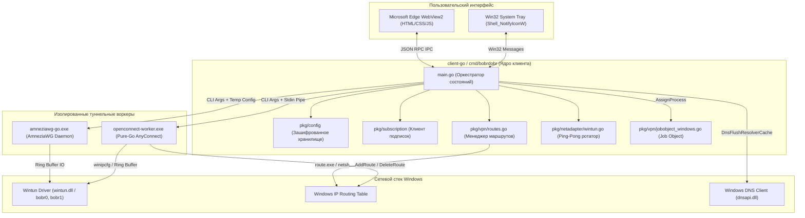
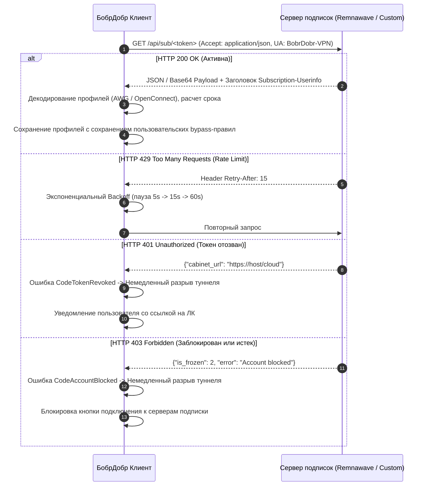

# Глубокий технический анализ кодовой базы Windows VPN клиента BobrDobr VPN (v1.3.2)
**Дата исследования**: 16 ноября 2026 г.  
**Исследуемый репозиторий**: `C:\Users\Egor\Documents\DevTools_Super_Debug\VPN_Windows_Client`  
**Технологический стек**: Go 1.24 (Pure-Go Native Core), uTLS, pion/dtls/v3, Wintun, Microsoft Edge WebView2, Win32 API.

---

## Содержание
1. [Архитектура проекта и модульная структура](#1-архитектура-проекта-и-модульная-структура)
   - [1.1 Структура пакетов client-go](#11-структура-пакетов-client-go)
   - [1.2 Архитектура и устройство openconnect-worker](#12-архитектура-и-устройство-openconnect-worker)
2. [Поддерживаемые протоколы и VPN-движки](#2-поддерживаемые-протоколы-и-vpn-движки)
   - [2.1 AmneziaWG: параметры обфускации и управление процессом](#21-amneziawg-параметры-обфускации-и-управление-процессом)
   - [2.2 OpenConnect / AnyConnect: CSTP, DTLS, uTLS и камуфляж](#22-openconnect--anyconnect-cstp-dtls-utls-и-камуфляж)
3. [Сетевое управление, маршрутизация и системная интеграция](#3-сетевое-управление-маршрутизация-и-системная-интеграция)
   - [3.1 TUN-стек Wintun, Ping-Pong ротация и устранение утечек адаптеров](#31-tun-стек-wintun-ping-pong-ротация-и-устранение-утечек-адаптеров)
   - [3.2 Маршрутизация, Split Tunneling и алгоритм вычитания CIDR](#32-маршрутизация-split-tunneling-и-алгоритм-вычитания-cidr)
   - [3.3 Управление DNS и защита от утечек (DNS Leak Protection)](#33-управление-dns-и-защита-от-утечек-dns-leak-protection)
   - [3.4 Межпроцессное взаимодействие (IPC) и изоляция процессов](#34-межпроцессное-взаимодействие-ipc-и-изоляция-процессов)
4. [Профили, хранилище и сервер подписок](#4-профили-хранилище-и-сервер-подписок)
   - [4.1 Криптографическое хранилище (DPAPI + AES-256-GCM)](#41-криптографическое-хранилище-dpapi--aes-256-gcm)
   - [4.2 Протокол сервера подписок: API, коды ошибок, Rate-Limiting](#42-протокол-сервера-подписок-api-коды-ошибок-rate-limiting)
5. [Руководство по переносу и адаптации паттернов на мобильную платформу (Android / iOS)](#5-руководство-по-переносу-и-адаптации-паттернов-на-мобильную-платформу-android--ios)
   - [5.1 Сравнительная матрица платформ](#51-сравнительная-матрица-платформ)
   - [5.2 Архитектурные паттерны для реализации на Android (VpnService + Go/Rust)](#52-архитектурные-паттерны-для-реализации-на-android-vpnservice--gorust)

---

## 1. Архитектура проекта и модульная структура

Проект BobrDobr VPN для Windows представляет собой высокопроизводительное монолитное приложение-координатор на **Go 1.24**, управляющее двумя специализированными туннельными процессами:
1. `bin/windows/amneziawg-go.exe` — форк WireGuard Go с обфускацией заголовков и мусорными пакетами.
2. `bin/windows/openconnect-worker.exe` — собственная pure-Go реализация клиента AnyConnect/CSTP/DTLS с интеграцией библиотеки `uTLS`.



---

### 1.1 Структура пакетов client-go

Исходный код главного приложения сосредоточен в каталоге `client-go/`:

#### `client-go/cmd/bobrdobr/`
- `main.go` ([main.go](file:///C:/Users/Egor/Documents/DevTools_Super_Debug/VPN_Windows_Client/client-go/cmd/bobrdobr/main.go)):
  - Центральная точка входа (1953 строки).
  - Инициализирует единый инстанс (`singleinstance`), логгер, зашифрованный стор (`config.Store`), ротатор адаптеров (`netadapter.AdapterManager`), менеджер маршрутов (`vpn.RouteManager`), GUI на базе WebView2 (`gui.GUI`) и системный трей (`tray.Tray`).
  - Реализует конечный автомат состояний туннеля (`StateDisconnected`, `StateConnecting`, `StateConnected`, `StateDisconnecting`, `StateError`).
  - Управляет **бесшовным быстрым переключением серверов (Fast-Switching)**: при клике на другой сервер немедленно запускает процедуру остановки старого соединения, ротацию сетевого имени адаптера `bobr0` <-> `bobr1` и подъем нового туннеля без перезапуска графического интерфейса.
  - Обрабатывает фоновую периодическую синхронизацию подписки, автоматическое отключение туннеля при отмене/истечении подписки (HTTP 401/403) и принудительный разрыв связи при удалении активного профиля из интерфейса.
- `firewall_windows.go` ([firewall_windows.go](file:///C:/Users/Egor/Documents/DevTools_Super_Debug/VPN_Windows_Client/client-go/cmd/bobrdobr/firewall_windows.go)):
  - Функция `ensureFirewallRule`: автоматическое добавление разрешающих входящих правил в Windows Defender Firewall через `netsh advfirewall firewall add rule` для бинарников воркеров.
- `aumid_windows.go` ([aumid_windows.go](file:///C:/Users/Egor/Documents/DevTools_Super_Debug/VPN_Windows_Client/client-go/cmd/bobrdobr/aumid_windows.go)):
  - Регистрация Windows Application User Model ID (`BobrDobr.VPN.Client.1.3`) для корректной группировки окон в панели задач Windows 10/11 и показа нативных Toast-уведомлений.

#### `client-go/pkg/vpn/`
- `amnezia.go` ([amnezia.go](file:///C:/Users/Egor/Documents/DevTools_Super_Debug/VPN_Windows_Client/client-go/pkg/vpn/amnezia.go)):
  - `AmneziaSupervisor`: управляет жизненным циклом процесса `amneziawg-go.exe`.
  - Запуск дочернего процесса с параметрами `-config <conf_path> -name <interface_name>`, инъекция директории с `wintun.dll` в переменную среды `PATH`, асинхронный построчный парсинг stdout/stderr для детекции событий соединения (`"device started"`, `"peer handshake"`) или ошибок.
  - Привязка PID к Windows Job Object.
- `openconnect.go` ([openconnect.go](file:///C:/Users/Egor/Documents/DevTools_Super_Debug/VPN_Windows_Client/client-go/pkg/vpn/openconnect.go)):
  - `OpenConnectSupervisor`: управляет бинарником `openconnect-worker.exe` (с автоматическим фоллбеком на legacy `openconnect.exe`).
  - Безопасная передача пароля через пайп `stdin` (`--passwd-on-stdin`), исключающая утечку учетных данных в список процессов Windows.
  - **Graceful Shutdown**: удерживает `stdinPipe` открытым в течение всего времени работы сессии. При вызове `Stop()` закрытие `stdinPipe` отправляет сигнал воркеру на отправку CSTP BYE пакета серверу перед завершением работы.
- `routes.go` ([routes.go](file:///C:/Users/Egor/Documents/DevTools_Super_Debug/VPN_Windows_Client/client-go/pkg/vpn/routes.go)) и `routes_windows.go`:
  - `RouteManager`: определение физического IP-шлюза по умолчанию (`DetectPhysicalGateway`) через разбор вывода `route print 0.0.0.0` и `netsh`.
  - Установка исключений маршрутизации (`ApplyBypassRoutes`): преобразование доменных имен, IP и CIDR-подсетей в прямые маршруты с метрикой 1 через физический шлюз (`route add <dest> mask <mask> <gw> metric 1 if <ifIndex>`).
- `cidr.go` ([cidr.go](file:///C:/Users/Egor/Documents/DevTools_Super_Debug/VPN_Windows_Client/client-go/pkg/vpn/cidr.go)):
  - Реализация математического алгоритма вычитания подсетей `SubtractCIDRs` и пересчета `AllowedIPs` для WireGuard/AmneziaWG.
- `jobobject_windows.go` ([jobobject_windows.go](file:///C:/Users/Egor/Documents/DevTools_Super_Debug/VPN_Windows_Client/client-go/pkg/vpn/jobobject_windows.go)):
  - Обертка над Win32 API `CreateJobObject`, `SetInformationJobObject` с флагом `JOB_OBJECT_LIMIT_KILL_ON_JOB_CLOSE`. Принудительное уничтожение ядром ОС всех дочерних сетевых воркеров при любом завершении основного приложения.
- `dns_flush_windows.go` ([dns_flush_windows.go](file:///C:/Users/Egor/Documents/DevTools_Super_Debug/VPN_Windows_Client/client-go/pkg/vpn/dns_flush_windows.go)):
  - Функция `FlushDNSCache`: низкоуровневый вызов `DnsFlushResolverCache()` из системной библиотеки `dnsapi.dll` (с резервным вызовом `ipconfig /flushdns`).

#### `client-go/pkg/netadapter/`
- `wintun.go` ([wintun.go](file:///C:/Users/Egor/Documents/DevTools_Super_Debug/VPN_Windows_Client/client-go/pkg/netadapter/wintun.go)) и `wintun_windows.go` ([wintun_windows.go](file:///C:/Users/Egor/Documents/DevTools_Super_Debug/VPN_Windows_Client/client-go/pkg/netadapter/wintun_windows.go)):
  - `AdapterManager`: реализует механизм **Ping-Pong ротации адаптеров** (`bobr0` <-> `bobr1`). Это устраняет гонку Plug-and-Play деинициализации драйвера Wintun при быстрых повторных подключениях.
  - Поиск сиротских Wintun-интерфейсов через сканирование реестра Windows (`HKLM\SYSTEM\CurrentControlSet\Enum\SWD\WINTUN`) и их удаление через `pnputil.exe /remove-device <instance_id> /subtree`.
  - Сбор сетевой телеметрии (RX/TX байты) через Win32 `ConvertInterfaceNameToLuidW` и `GetIfEntry2Ex`.

#### `client-go/pkg/config/`
- `models.go` ([models.go](file:///C:/Users/Egor/Documents/DevTools_Super_Debug/VPN_Windows_Client/client-go/pkg/config/models.go)):
  - Структуры `Profile`, `AmneziaWGConfig`, `OpenConnectConfig`, `Settings`.
- `store.go` ([store.go](file:///C:/Users/Egor/Documents/DevTools_Super_Debug/VPN_Windows_Client/client-go/pkg/config/store.go)):
  - Потокобезопасное хранилище `Store` с защитой от сбоев питания: атомарная запись во временный файл `.tmp`, ротация в `.bak` и основной `settings.json`.
  - Автоматическая миграция legacy-конфигураций из старой Python-версии клиента (`migrateLegacyConfig`).
- `crypto.go` ([crypto.go](file:///C:/Users/Egor/Documents/DevTools_Super_Debug/VPN_Windows_Client/client-go/pkg/config/crypto.go)) и `dpapi_windows.go`:
  - `StorageEnvelope`: формат сохранения зашифрованных данных.
  - `CompositeEncryptor`: прозрачная поддержка расшифровки как аппаратного DPAPI, так и переносимого AES-256-GCM (ключ генерируется через PBKDF2 от аппаратного отпечатка системы `GetHardwareDerivedKey`).

#### `client-go/pkg/subscription/`
- `client.go` ([client.go](file:///C:/Users/Egor/Documents/DevTools_Super_Debug/VPN_Windows_Client/client-go/pkg/subscription/client.go)):
  - HTTP-клиент с принудительным TLS 1.2+ и HTTP/2.
  - Обработка HTTP 429 (Too Many Requests) с экспоненциальным backoff и парсингом заголовка `Retry-After`.
  - Строгая типизация ошибок через `ServerError` (`CodeTokenRevoked`, `CodeAccountBlocked`, `CodeSubExpired`, `CodeRateLimited`).
- `parser.go` ([parser.go](file:///C:/Users/Egor/Documents/DevTools_Super_Debug/VPN_Windows_Client/client-go/pkg/subscription/parser.go)):
  - Универсальный парсер подписок: декодирование JSON-объекта, JSON-массива, base64-строк и сырых WireGuard `.conf` файлов.
  - Преобразование сетевых параметров AWG (Jc, Jmin, Jmax, S1, S2, H1..H4) и OpenConnect (Camouflage, DTLS, SNI) в нативные модели профилей.
  - Вычисление дней до окончания подписки и выявление статуса заморозки (`is_frozen`).

---

### 1.2 Архитектура и устройство openconnect-worker

Проект `openconnect-worker/` — это полностью автономный, скомпилированный на чистом Go клиент протокола AnyConnect (Cisco CSTP / ocserv), заменивший тяжелый си-шный `openconnect.exe` и 18 динамических библиотек MinGW.

```
openconnect-worker/
├── auth/
│   ├── auth.go               # XML-хендшейк AnyConnect, обработка куки webvpn, парсинг профиля
│   └── utls_test.go          # Тесты совместимости uTLS
├── base/
│   ├── config.go             # Глобальная конфигурация воркера
│   ├── log.go                # Потокобезопасный логгер
│   └── setup.go              # Структуры описания локального физического сетевого интерфейса
├── proto/
│   ├── dtd.go                # XML структуры (config-auth init, auth-reply)
│   └── protocol.go           # Константы заголовка CSTP (STF\x01) и типы пакетов
├── session/
│   └── session.go            # Состояние сессии: ключи, токены, метрики, DPD и Keepalive таймеры
├── tun/
│   ├── tun.go                # Интерфейс TUN Device
│   └── tun_windows.go        # Интеграция с golang.zx2c4.com/wintun, сессия с Ring Buffer 8 МБ
├── utils/
│   ├── tls.go                # DialBrowserTLS: инициализация uTLS с отпечатком Chrome и ALPN http/1.1
│   ├── vpnc/vpnc_windows.go  # Настройка IP/DNS и маршрутизации через winipcfg
│   └── waterutil/            # Низкоуровневый разбор заголовков IPv4/TCP/UDP
├── vpn/
│   ├── buffer.go             # sync.Pool буферов пакетов (минимизация аллокаций)
│   ├── dtls.go               # UDP DTLS канал на базе pion/dtls/v3
│   ├── tls.go                # TCP CSTP канал (чтение и запись кадров STF\x01)
│   ├── tun.go                # Мультиплексор пакетов TUN <-> (TLS / DTLS) и динамический DNS-сплит
│   └── tunnel.go             # HTTP CONNECT рукопожатие (/CSCOSSLC/tunnel) и инициализация сессии
└── main.go                   # Точка входа, разбор аргументов CLI и graceful teardown
```

#### Ключевые механизмы openconnect-worker:
1. **uTLS Browser Camouflage** (`utils/tls.go`, строки 12–68):
   - Инициализирует соединение с использованием пресета `tls.HelloChrome_Auto`.
   - Подменяет ALPN на строго фиксированный `[]string{"http/1.1"}`. Серверы AnyConnect требуют именно HTTP/1.1 для выполнения метода `CONNECT /CSCOSSLC/tunnel`. Если бы согласовывался HTTP/2, туннель бы не поднялся.
2. **Аутентификация AnyConnect XML** (`auth/auth.go`, строки 86–235):
   - Клиент отправляет XML `<config-auth client="vpn" type="init">` с информацией об устройстве.
   - Получает ответ с формой авторизации и списком групп.
   - Отправляет XML `<config-auth client="vpn" type="auth-reply">` с логином, паролем и opaque-токенами.
   - В ответ сервер AnyConnect возвращает XML с `<session-token>`, либо сервер `ocserv` возвращает HTTP-заголовок `Set-Cookie: webvpn=...`.
3. **Установление туннеля (CSTP Connect)** (`vpn/tunnel.go`, строки 53–146):
   - Выполняется HTTP-запрос `CONNECT https://<host>/CSCOSSLC/tunnel`.
   - Передаются заголовки:
     - `Cookie: webvpn=<SessionToken>`
     - `X-CSTP-VPNAddress-Type: IPv4`
     - `X-CSTP-MTU: 1399`
     - `X-DTLS-Master-Secret: <hex>` — 48-байтный сгенерированный пре-мастер секрет для согласования вторичного UDP/DTLS канала.
     - `X-DTLS12-CipherSuite: ECDHE-ECDSA-AES256-GCM-SHA384:...`
   - Сервер отвечает `200 OK` с конфигурационными заголовками (`X-CSTP-Address`, `X-CSTP-Netmask`, `X-CSTP-DNS`, `X-DTLS-Port`, `X-DTLS-Session-ID`).
4. **CSTP Фрейминг (TCP)** (`proto/protocol.go`, строки 6–18; `vpn/tls.go`, строки 48–79, 105–120):
   - Каждый пакет в канале CSTP TLS предваряется 8-байтным заголовком:
     - Байты 0..3: Сигнатура `0x53, 0x54, 0x46, 0x01` (`"STF\x01"`).
     - Байты 4..5: Длина полезной нагрузки (Big-Endian `uint16`).
     - Байт 6: Тип пакета (`0x00` — DATA, `0x03` — DPD-REQ, `0x04` — DPD-RESP, `0x05` — DISCONNECT, `0x07` — KEEPALIVE).
     - Байт 7: Зарезервирован (`0x00`).
5. **DTLS Канал (UDP)** (`vpn/dtls.go`, строки 40–140):
   - Если сервер поддерживает DTLS и вернул `X-DTLS-Port`, воркер поднимает DTLS 1.2 сессию через `pion/dtls/v3`, используя сохраненный PreMasterSecret и SessionID.
   - В DTLS заголовок упрощен до **1 байта** (байт типа: `0x00` — DATA, `0x03` — DPD-REQ, `0x05` — DISCONNECT, `0x07` — KEEPALIVE).
6. **Двухканальное мультиплексирование** (`vpn/tun.go`, строки 89–103):
   - Поток `tunToPayloadOut`: читает пакеты из Wintun. Если DTLS подключен, пакет отправляется в `PayloadOutDTLS` (UDP). Если DTLS не согласован или упал — направляется в `PayloadOutTLS` (TCP/CSTP).
   - Поток `payloadInToTun`: читает пакеты из общего входного канала `PayloadIn` (куда складывают данные оба детектора — и TLS, и DTLS) и записывает их в виртуальный адаптер Wintun.
7. **Graceful CSTP Disconnect (BYE Packet)** (`session/session.go`, строки 238–258):
   - При завершении сессии клиент отправляет на сервер пакет типа `0x05` с телом `0xb0` + `"Client disconnect"`. Это гарантирует мгновенное освобождение сессии и IP-адреса на сервере, предотвращая ошибки превышения лимита одновременных подключений.

---

## 2. Поддерживаемые протоколы и VPN-движки

### 2.1 AmneziaWG: параметры обфускации и управление процессом

AmneziaWG расширяет стандартный протокол WireGuard механизмами защиты от блокировок по сигнатурам и эвристическому DPI-анализу (Deep Packet Inspection).

#### Параметры обфускации:
В кодовой базе параметры хранятся в модели `AmneziaWGConfig` ([models.go](file:///C:/Users/Egor/Documents/DevTools_Super_Debug/VPN_Windows_Client/client-go/pkg/config/models.go#L41-L59)):
- **`Jc` (Junk packet count)**: Количество мусорных (шумовых) UDP-пакетов, которые клиент отправляет на сервер перед началом хендшейка. Это сбивает эвристические анализаторы DPI, ожидающие строго определенный первый пакет.
- **`Jmin` и `Jmax` (Junk packet size range)**: Минимальный и максимальный размер полезной нагрузки (в байтах) для каждого случайного мусорного пакета.
- **`S1` (Init packet junk padding)**: Размер случайного байтового заполнения (padding), добавляемого к первому пакету инициализации рукопожатия (`Handshake Initiation`). Стандартный размер пакета WireGuard (148 байт) мгновенно детектируется ТСПУ/DPI; добавление S1 делает размер пакета непредсказуемым.
- **`S2` (Response packet junk padding)**: Размер случайного байтового заполнения для ответного пакета сервера (`Handshake Response`), маскирующий его стандартный размер (92 байта).
- **`H1`, `H2`, `H3`, `H4` (Custom Message Type Headers)**: Кастомные 4-байтные числовые заголовки типов сообщений AmneziaWG, заменяющие стандартные константы WireGuard в начале каждого пакета:
  - `H1` заменяет тип 1 (`Handshake Initiation`)
  - `H2` заменяет тип 2 (`Handshake Response`)
  - `H3` заменяет тип 3 (`Cookie Reply`)
  - `H4` заменяет тип 4 (`Data Packet`)

#### Генерация конфигурации AmneziaWG:
Функция `buildAmneziaWGConfigText` в `client-go/cmd/bobrdobr/main.go` (строки 111–168) на лету собирает стандартный INI-конфиг с секциями `[Interface]` и `[Peer]`, инжектируя параметры обфускации:
```ini
[Interface]
Address = 10.7.0.2/24
PrivateKey = <ClientPrivateKey>
DNS = 1.1.1.1
Jc = 4
Jmin = 40
Jmax = 70
S1 = 65
S2 = 45
H1 = 1284567891
H2 = 1484567892
H3 = 1684567893
H4 = 1884567894

[Peer]
PublicKey = <ServerPublicKey>
PresharedKey = <PresharedKey>
Endpoint = 198.51.100.1:51820
AllowedIPs = 0.0.0.0/0
```

#### Запуск и мониторинг amneziawg-go:
1. Конфигурация сохраняется во временный файл `os.CreateTemp("", "awg_*.conf")` ([amnezia.go](file:///C:/Users/Egor/Documents/DevTools_Super_Debug/VPN_Windows_Client/client-go/pkg/vpn/amnezia.go#L136-L150)).
2. Формируются аргументы вызова:
   ```cmd
   amneziawg-go.exe -config C:\Users\...\AppData\Local\Temp\awg_12345.conf -name bobr0
   ```
3. Директория с `wintun.dll` динамически добавляется в начало переменной среды `PATH` для процесса.
4. Процесс стартует со скрытым окном (`CREATE_NO_WINDOW`) и привязывается к Windows Job Object.
5. Горутины сканируют stdout и stderr. При обнаружении маркерных строк (`"device started"`, `"interface created"`, `"handshake successful"`) генерируется внутреннее событие `StateConnected`.
6. При остановке туннеля временный файл конфига гарантированно удаляется (`cleanupTempConfig`), а процесс завершается. Так как WireGuard работает по протоколу UDP без сессионных пакетов завершения, закрытие дескриптора Wintun адаптера автоматически приводит к сворачиванию виртуального сетевого интерфейса драйвером ядра Windows.

---

### 2.2 OpenConnect / AnyConnect: CSTP, DTLS, uTLS и камуфляж

Воркер `openconnect-worker.exe` реализует полноценный клиентский стек AnyConnect без внешних C-зависимостей:

1. **Маскировка URL и Camouflage Secret Token**:
   - Воркер поддерживает работу через секретные URI-токены маскировки для защиты от активного зондирования цензорами (когда DPI пытается открыть страницу сервера обычным браузером и видит заглушку 404/403, если не передан секретный путь).
   - Разбор пути реализован в `parseTarget` ([openconnect-worker/main.go](file:///C:/Users/Egor/Documents/DevTools_Super_Debug/VPN_Windows_Client/openconnect-worker/main.go#L242-L297)):
     `https://vpn.example.com:443/?secret_key` или `https://vpn.example.com/custom_path`.
   - Токен передается в query параметрах каждого авторизационного POST-запроса (`tplPost` в [auth.go](file:///C:/Users/Egor/Documents/DevTools_Super_Debug/VPN_Windows_Client/openconnect-worker/auth/auth.go#L182)).

2. **Браузерный TLS-стек (uTLS)**:
   - В файле `utils/tls.go` создается `tls.UClient` поверх обычного TCP-сокета.
   - Загружается спека `tls.UTLSIdToSpec(tls.HelloChrome_Auto)`.
   - Применяется модификация расширений: список ALPN принудительно заменяется на `["http/1.1"]`.
   - Это гарантирует, что TLS ClientHello неотличим от современного браузера Google Chrome (включая кривые GREASE, расширения SNI, padding, распределение cipher suites), что предотвращает блокировку на DPI по отпечаткам OpenSSL/GnuTLS.

3. **Координация жизненного цикла через Stdin Pipe**:
   - Координатор `client-go` запускает воркер с флагами `--stdin-control` и `--passwd-on-stdin`.
   - Пароль профиля передается первой строкой через пайп стандартного ввода, после чего пайп **остается открытым**.
   - Воркер слушает stdin в отдельной горутине ([openconnect-worker/main.go](file:///C:/Users/Egor/Documents/DevTools_Super_Debug/VPN_Windows_Client/openconnect-worker/main.go#L153-L174)).
   - Когда координатор вызывает `OpenConnectSupervisor.Stop()`, он просто закрывает `stdinPipe.Close()`.
   - Воркер ловит событие `io.EOF`, инициирует процедуру грациозного завершения:
     1. Восстанавливает исходные маршруты (`vpnc.ResetRoutes`).
     2. Отправляет AnyConnect CSTP BYE пакет (`SendBye`).
     3. Закрывает адаптер Wintun.
     4. Завершает процесс с кодом 0 за 100–250 мс.

---

## 3. Сетевое управление, маршрутизация и системная интеграция

### 3.1 TUN-стек Wintun, Ping-Pong ротация и устранение утечек адаптеров

Драйвер Wintun (разработка команды WireGuard) работает в пространстве ядра Windows и обеспечивает максимальную пропускную способность за счет механизма циклического буфера обмена памятью (Ring Buffer) без оверхеда традиционного NDIS-пакета TAP-Windows.

#### Устранение проблем демонтажа Wintun ("Ping-Pong Rotation"):
При частых переключениях серверов (Fast-Switching) драйвер Wintun в ядре Windows освобождает сетевой интерфейс асинхронно через диспетчер Plug-and-Play (PnP). Если попытаться повторно поднять интерфейс с тем же именем `bobr0` через несколько сотен миллисекунд, возникает системная ошибка `cannot create a file when that file already exists`.

Для решения этой проблемы в `client-go/pkg/netadapter/wintun.go` реализован **паттерн ротации**:
- Менеджер `AdapterManager` чередует имя создаваемого адаптера между `bobr0` и `bobr1` (а при необходимости задействует `bobr2`...`bobr9`).
- Перед назначением адаптера проверяется его занятость (`IsAdapterBusy`) в сетевом стеке и реестре.
- Пока система удаляет предыдущий адаптер в фоновом режиме, новое VPN-подключение немедленно поднимается на альтернативном имени, обеспечивая мгновенное переключение серверов.

#### Очистка сиротских (Orphan) адаптеров:
Если система аварийно выключилась или процесс был принудительно убит, адаптеры Wintun могут остаться в реестре.
- Пакет `netadapter` при старте сканирует ключ реестра:
  `HKLM\SYSTEM\CurrentControlSet\Enum\SWD\WINTUN`
- Сопоставляет GUID устройств с их именами через:
  `HKLM\SYSTEM\CurrentControlSet\Control\Network\{4d36e972-e325-11ce-bfc1-08002be10318}\{GUID}\Connection`
- Для интерфейсов с префиксом `bobr*` и `awg*` выполняется команда удаления PnP-устройства:
  `pnputil.exe /remove-device <InstanceID> /subtree`
- Сторонние сетевые адаптеры (Ethernet, Wi-Fi, Tailscale, ZeroTier) жестко защищены белым списком и никогда не затрагиваются.

---

### 3.2 Маршрутизация, Split Tunneling и алгоритм вычитания CIDR

Раздельное туннелирование в BobrDobr VPN реализовано на двух взаимодополняющих уровнях:

```
+---------------------------------------------------------------------------------+
|                                 Пользователь                                    |
|                      Задает домены обхода (gosuslugi.ru, 2ip.ru)                |
+---------------------------------------------------------------------------------+
                                       |
                                       v
+---------------------------------------------------------------------------------+
|                        client-go (cmd/bobrdobr/main.go)                         |
|                                                                                 |
| 1. Pre-resolving доменов в IPv4 ДО поднятия туннеля (защита от DNS-спуфинга VPN)|
| 2. Определение физического интернет-шлюза (DetectPhysicalGateway)                |
+---------------------------------------------------------------------------------+
          |                                                       |
          | Для AmneziaWG                                         | Для обоих протоколов
          v                                                       v
+------------------------------------+  +-----------------------------------------+
| Алгоритм SubtractCIDRs             |  | RouteManager.ApplyBypassRoutes          |
| Вычитает IP исключений из 0.0.0.0/0|  | Добавляет в таблицу маршрутизации ОС:   |
| Формирует список разрешенных CIDR  |  | route add <IP> mask 255.255.255.255 <GW>|
| и заменяет AllowedIPs в конфиге    |  |       metric 1 if <PhysicalInterfaceIdx>|
+------------------------------------+  +-----------------------------------------+
          |                                                       |
          v                                                       v
+------------------------------------+  +-----------------------------------------+
| Драйвер AmneziaWG / WFP            |  | Таблица маршрутов ядра Windows          |
| Трафик исключений НЕ блокируется   |  | Пакеты уходят напрямую в физический     |
| внутренним файрволом WireGuard     |  | роутер в обход туннеля (Longest Prefix) |
+------------------------------------+  +-----------------------------------------+
```

#### 1. Защита от отравления DNS при пре-резолвинге:
В `main.go` (строки 722–726) домены из списков исключений резолвятся функцией `PreResolveBypassEntries` **до** того, как виртуальный адаптер VPN перехватит системный DNS. Это исключает ситуацию, когда VPN-сервер подменяет IP-адрес или возвращает внутренний IP, ломая локальный доступ к сайту.

#### 2. Проблема файрвола Windows Filtering Platform (WFP) в WireGuard:
На Windows служба `wireguard-go` / `amneziawg-go` устанавливает фильтры WFP, которые принудительно блокируют или захватывают любой трафик, не попадающий в диапазон `AllowedIPs`. Если в конфиге указан `AllowedIPs = 0.0.0.0/0`, добавление прямого маршрута через `route.exe` не сработает — драйвер WireGuard перехватит или сбросит эти пакеты на уровне WFP.

#### 3. Алгоритм вычитания CIDR (`SubtractCIDRs` в `pkg/vpn/cidr.go`):
Чтобы решить эту проблему, BobrDobr VPN программно исключает адреса обхода из `0.0.0.0/0`:
- Функция `SubtractCIDRs(baseCIDR, excludeCIDRs)` рекурсивно делит базовый блок `/0` пополам (на `/1`: `0.0.0.0/1` и `128.0.0.0/1`), спускаясь по префиксному дереву до тех пор, пока не локализует исключаемый адрес `/32`.
- В результате `AllowedIPs` пересчитывается в компактное объединение непересекающихся подсетей (например, десятки диапазонов вместо `0.0.0.0/0`), в которых адрес исключения физически отсутствует.
- Параллельно `RouteManager` устанавливает маршрут к этому адресу через физический шлюз с метрикой 1. Трафик гарантированно идет через физический сетевой адаптер.

---

### 3.3 Управление DNS и защита от утечек (DNS Leak Protection)

1. **Применение DNS на Wintun интерфейсе**:
   - В `openconnect-worker` DNS назначается через API `winipcfg.SetDNS()` непосредственно на LUID виртуального адаптера.
   - В `amneziawg-go` DNS прописывается в секции `[Interface] DNS = ...`, и служба Wintun привязывает DNS-сервер к адаптеру.
2. **Мгновенный сброс кеша DNS**:
   - При каждом дисконнекте или переключении профилей вызывается `FlushDNSCache()` ([dns_flush_windows.go](file:///C:/Users/Egor/Documents/DevTools_Super_Debug/VPN_Windows_Client/client-go/pkg/vpn/dns_flush_windows.go)):
     ```go
     procDnsFlushResolverCache = modDnsapi.NewProc("DnsFlushResolverCache")
     procDnsFlushResolverCache.Call()
     ```
   - Это предотвращает кэширование локальным DNS-резолвером Windows устаревших записей от внутреннего VPN-сервера.

---

### 3.4 Межпроцессное взаимодействие (IPC) и изоляция процессов

1. **Гарантированное завершение процессов через Windows Job Objects** ([jobobject_windows.go](file:///C:/Users/Egor/Documents/DevTools_Super_Debug/VPN_Windows_Client/client-go/pkg/vpn/jobobject_windows.go)):
   - При старте `client-go` создает объект ядра Windows Job Object с атрибутом:
     `info.BasicLimitInformation.LimitFlags = windows.JOB_OBJECT_LIMIT_KILL_ON_JOB_CLOSE`
   - Все порожденные процессы (`amneziawg-go.exe`, `openconnect-worker.exe`) немедленно привязываются к объекту через `AssignProcessToJobObject`.
   - Если основное приложение завершается штатно, по ошибке, через диспетчер задач или в результате сбоя питания, **ядро Windows автоматически и безусловно уничтожает все дочерние туннельные процессы**. Исключены любые утечки зомби-процессов и зависших туннелей.

2. **IPC между GUI (WebView2) и Go**:
   - WebView2 общается с Go через двунаправленный мост `window.chrome.webview.postMessage(JSON)` -> Go handler `ui.On(action, callback)`.
   - Ответные события из Go в JS отправляются через `ui.Emit(eventName, data)` -> `window.handleGoEvent(event, data)`.

3. **IPC между экземплярами приложения (Single Instance)**:
   - Синхронизация между запускаемыми экземплярами выполнена на базе именованного канала (Named Pipe) `\\.\pipe\BobrDobr_SingleInstance_Pipe` и системного мьютекса `Local\BobrDobr_SingleInstance_Mutex`.
   - Используется дескриптор безопасности SDDL низкого уровня целостности (`LowIntegritySDDL`), что позволяет процессам без повышенных привилегий передавать команды активации окна окну с повышенными правами администратора.

---

## 4. Профили, хранилище и сервер подписок

### 4.1 Криптографическое хранилище (DPAPI + AES-256-GCM)

Конфигурация приложения хранится в `%APPDATA%\BobrDobr\settings.json`. Хранилище защищено криптографическим конвертом `StorageEnvelope`:

```json
{
  "version": 1,
  "encryption": "dpapi",
  "salt": "",
  "nonce": "",
  "data": "AQAAANCMnd8BFdERjHoAwE/Cl+sBAAAA..."
}
```

- **Основной метод шифрования на Windows**: `dpapi` (Windows Data Protection API). Вызовы `windows.CryptProtectData` и `windows.CryptUnprotectData` осуществляют шифрование на системных ключах текущей учетной записи пользователя Windows с аппаратной привязкой.
- **Резервный переносимый метод**: `aes-256-gcm`. Использует 256-битный ключ, получаемый через PBKDF2 (10000 итераций SHA-256) от аппаратного идентификатора машины (`GetHardwareDerivedKey`: комбинация `Hostname`, `Username`, `Machine-ID`, `OS/Arch` и статической соли приложения).
- **Отказоустойчивость**: запись всегда производится во временный файл `settings.json.tmp`, затем обновляется резервная копия `settings.json.bak`, после чего атомарно перезаписывается основной файл `settings.json`. При повреждении файла хранилище автоматически восстанавливается из `.bak`.

---

### 4.2 Протокол сервера подписок: API, коды ошибок, Rate-Limiting

Взаимодействие с сервером подписки реализовано в пакете `pkg/subscription/`:



#### Формат ответа сервера:
Сервер подписки возвращает JSON следующей структуры:
```json
{
  "status": "active",
  "is_frozen": 0,
  "cabinet_url": "https://vpn.example.com/cloud",
  "user": {
    "id": 12345,
    "username": "user_bobr",
    "role": "client",
    "expires_at": 1795000000,
    "is_frozen": 0
  },
  "connections": [
    {
      "id": "conn-1",
      "name": "NL - Amsterdam Highspeed",
      "proto": "awg",
      "endpoint": "198.51.100.10:51820",
      "address": "10.8.0.2/24",
      "dns": "1.1.1.1",
      "private_key": "...",
      "public_key": "...",
      "preshared_key": "...",
      "allowed_ips": "0.0.0.0/0",
      "jc": 4, "jmin": 50, "jmax": 80,
      "s1": 45, "s2": 60,
      "h1": 1024, "h2": 2048, "h3": 3072, "h4": 4096
    },
    {
      "id": "conn-2",
      "name": "DE - Frankfurt AnyConnect",
      "proto": "openconnect",
      "server": "vpn.example.com",
      "port": 443,
      "username": "user_bobr",
      "password": "secret_password",
      "protocol": "anyconnect",
      "camouflage": {
        "enabled": true,
        "secret": "my_secret_token"
      }
    }
  ]
}
```

#### Обработка статусов подписки:
- Поле `is_frozen`:
  - `0`: Подписка активна (`StatusActive`).
  - `1`: Срок действия истек (`StatusExpired`).
  - `2`: Аккаунт заблокирован администратором (`StatusBlocked`).
- При изменении статуса на `blocked`, `expired` или `revoked` активный VPN-туннель **немедленно и принудительно разрывается** ([main.go](file:///C:/Users/Egor/Documents/DevTools_Super_Debug/VPN_Windows_Client/client-go/cmd/bobrdobr/main.go#L950-L986)).
- **Сохранение локальных настроек пользователя**: метод `SaveSubscriptionProfile` в `store.go` гарантирует, что добавленные пользователем домены обхода (`BypassDomains`) и признак раздельного туннелирования (`SplitTunnel`) не затираются при фоновом обновлении конфигурации с сервера.

---

## 5. Руководство по переносу и адаптации паттернов на мобильную платформу (Android / iOS)

### 5.1 Сравнительная матрица платформ

| Компонент / Задача | Реализация в Windows Client | Реализация в Android (Kotlin + Go/Rust) | Реализация в iOS (Swift + Go/Rust) |
| :--- | :--- | :--- | :--- |
| **Виртуальный адаптер** | Драйвер `Wintun.dll` (userspace ring buffer) | `android.net.VpnService` (`ParcelFileDescriptor`, `int fd`) | `NEPacketTunnelProvider` (`packetFlow`) |
| **Изоляция процессов** | Отдельные процессы `.exe` + Windows Job Object | Единый Android процесс (библиотеки `.so` через JNI / Go Mobile) | Единый Network Extension процесс (`.appex`) |
| **Предотвращение петель маршрутизации** | Маршруты метрики 1 через физический шлюз (`route.exe`) | `VpnService.protect(int socketFd)` | `NWUDPSession` / `bindToInterface` |
| **Split Tunneling (Исключения)** | Вычитание CIDR (`SubtractCIDRs`) + маршруты | `VpnService.Builder.addDisallowedApplication` (по приложениям) и `addRoute` (по IP) | `NEIPv4Settings.includedRoutes` / `excludedRoutes` |
| **TLS-стек (uTLS)** | `github.com/refraction-networking/utls` | Тот же код на Go (компилируется под `android/arm64`) | Тот же код на Go (компилируется под `ios/arm64`) |
| **Протокол AnyConnect** | CSTP/DTLS воркер (`openconnect-worker`) | Тот же Go-пакет, передающий пакеты напрямую в Android `fd` | Тот же Go-пакет, обменивающийся пакетами с `packetFlow` |
| **AmneziaWG Engine** | `amneziawg-go.exe` (внешний процесс) | `amneziawg-go` или Rust `amnezia-wg` библиотека, работающая в горутине/потоке | In-process фреймворк на базе Go или Rust |
| **Хранилище секретов** | Windows DPAPI (`CryptProtectData`) | Android Keystore + `EncryptedSharedPreferences` | iOS Keychain Services (`kSecClassGenericPassword`) |
| **Сброс DNS** | Win32 API `DnsFlushResolverCache` | Не требуется (система изолирует DNS-пространство туннеля) | Не требуется (управляется `NEDNSSettings`) |
| **Fast-Switching** | Ротация адаптеров `bobr0` <-> `bobr1` | Вызов `Builder.establish()` поверх старого дескриптора | Вызов `setTunnelNetworkSettings` поверх существующего туннеля |

---

### 5.2 Архитектурные паттерны для реализации на Android (VpnService + Go/Rust)

На основе анализа Windows-клиента для реализации мобильной версии рекомендуется перенести ключевые алгоритмы в общий сетевой модуль:

#### 1. Модель "In-Process Core" вместо внешних дочерних процессов
На Android запуск сторонних бинарников через `exec()` внутри песочницы приложений (sandbox) строго ограничен SELinux, а создание процессов на каждый протокол ведет к избыточному потреблению оперативной памяти и батареи.
- Вся сетевая логика `openconnect-worker` и `amneziawg` должна быть собрана в виде разделяемой библиотеки (`.so`) через **Go Mobile** или **CGO / Rust FFI**.
- Вместо взаимодействия через пайпы stdin/stdout управление вызовами (Start, Stop, GetStats) выполняется через прямые JNI-методы.

#### 2. Защита сокетов через `VpnService.protect()`
Самое критичное отличие мобильной платформы от Windows:
- На Windows транспортный сокет не зацикливается, потому что в таблицу маршрутов добавляются прямые маршруты до VPN-сервера через физический шлюз.
- На Android сокет **обязан** быть защищен вызовом `VpnService.protect(int fd)`.
- В Go это реализуется перехватом системного вызова создания сокета через `net.Dialer.Control`:
```go
dialer := &net.Dialer{
    Control: func(network, address string, c syscall.RawConn) error {
        return c.Control(func(fd uintptr) {
            // Вызов Java VpnService.protect(int fd) через JNI-коллбэк
            if !androidProtectSocket(int(fd)) {
                log.Println("Не удалось защитить сокет от петли маршрутизации")
            }
        })
    },
}
```
Этот же механизм применяется как для TCP-сокета CSTP uTLS, так и для UDP-сокета DTLS и AmneziaWG.

#### 3. Переиспользование парсера подписок и логики вычитания CIDR
Пакет `client-go/pkg/subscription` полностью платформонезависим (pure Go) и может быть перенесен в Android без изменений:
- Парсинг ответов сервера Remnawave/Custom JSON.
- Экспоненциальный backoff при HTTP 429.
- Обработка кодов ошибок `is_frozen` (0, 1, 2) и отзывов токенов (HTTP 401/403).
- Алгоритм `SubtractCIDRs` из `pkg/vpn/cidr.go` идеально подходит для генерации вызовов `VpnService.Builder.addRoute()` при реализации IP-based Split Tunneling.

#### 4. Сохранение логики AnyConnect CSTP/DTLS
Пакеты `openconnect-worker/auth`, `proto`, `vpn`, `utils/tls.go` на 100% готовы к компиляции под Android (`GOOS=android GOARCH=arm64`):
- uTLS с отпечатком Chrome и ALPN `http/1.1` работает на Android точно так же, обходя блокировки AnyConnect со стороны мобильных операторов.
- Горутина `tunToPayloadOut` просто читает пакеты из файлового дескриптора Linux `fd` (`os.NewFile(uintptr(fd), "tun")`), а `payloadInToTun` записывает их обратно.
- Грациозный разрыв соединения (`SendBye`) сохраняется в полном объеме, предотвращая зависание пользовательских сессий на стороне сервера.

---

## 6. Заключение

Кодовая база Windows-клиента BobrDobr VPN отличается продуманной архитектурой, эффективным решением проблем низкоуровневого сетевого стека Windows (Wintun PnP гонки, WFP-фильтрация WireGuard, утечки процессов через Job Objects) и собственной высококлассной реализацией протокола AnyConnect с uTLS-камуфляжем.

При проектировании мобильного клиента практически вся бизнес-логика (подписки, протокольные хендшейки, uTLS, обработка CSTP/DTLS кадров, AmneziaWG параметры) может быть повторно использована в виде единого нативного ядра, адаптируя лишь уровень захвата трафика (`VpnService` вместо Wintun) и защиту сокетов (`protect()` вместо ручной модификации таблицы маршрутов ОС).
